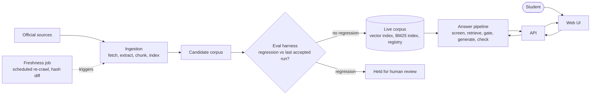
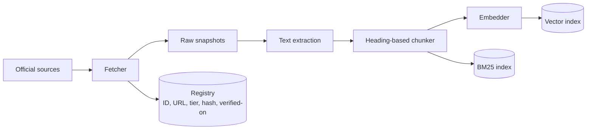
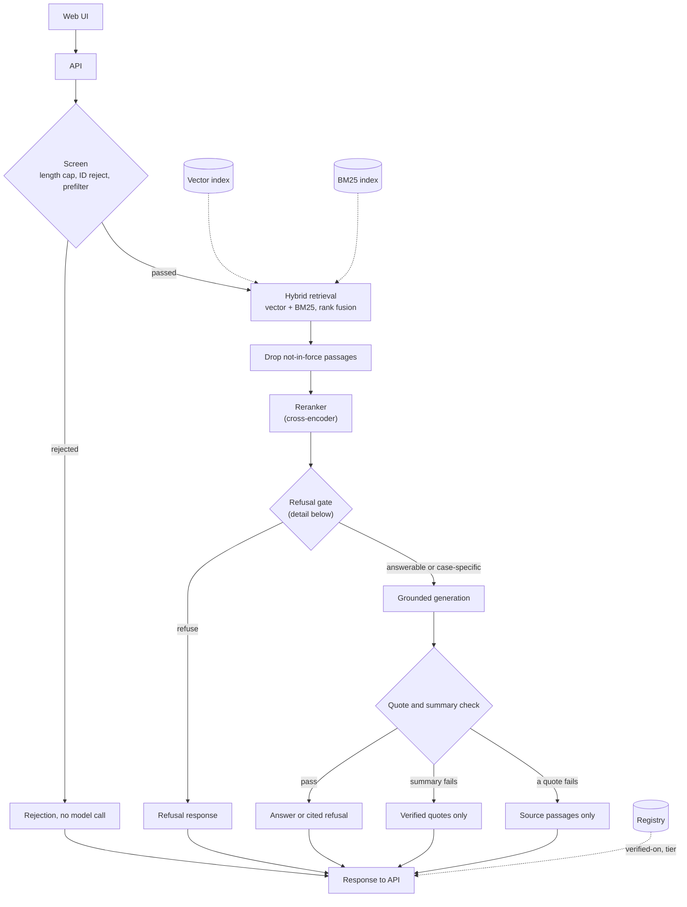
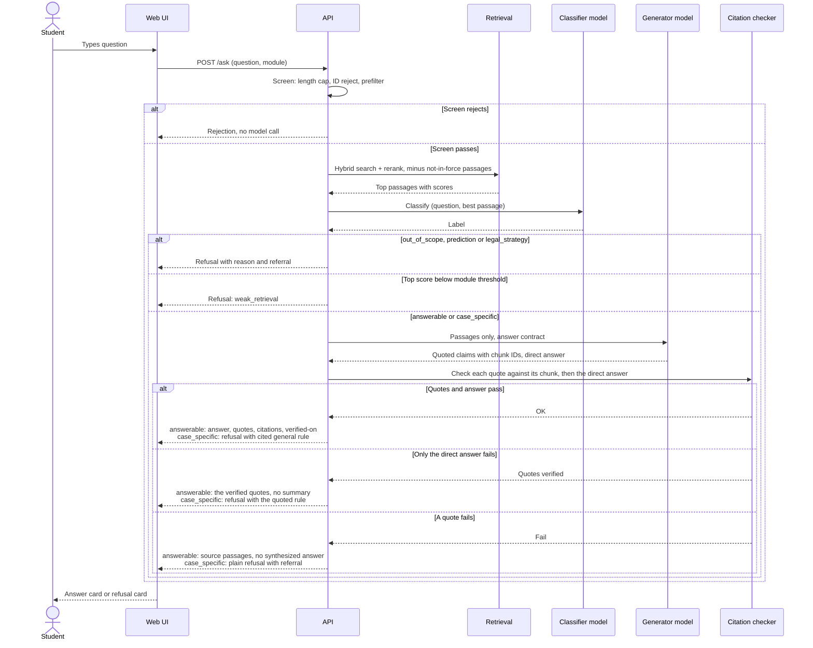
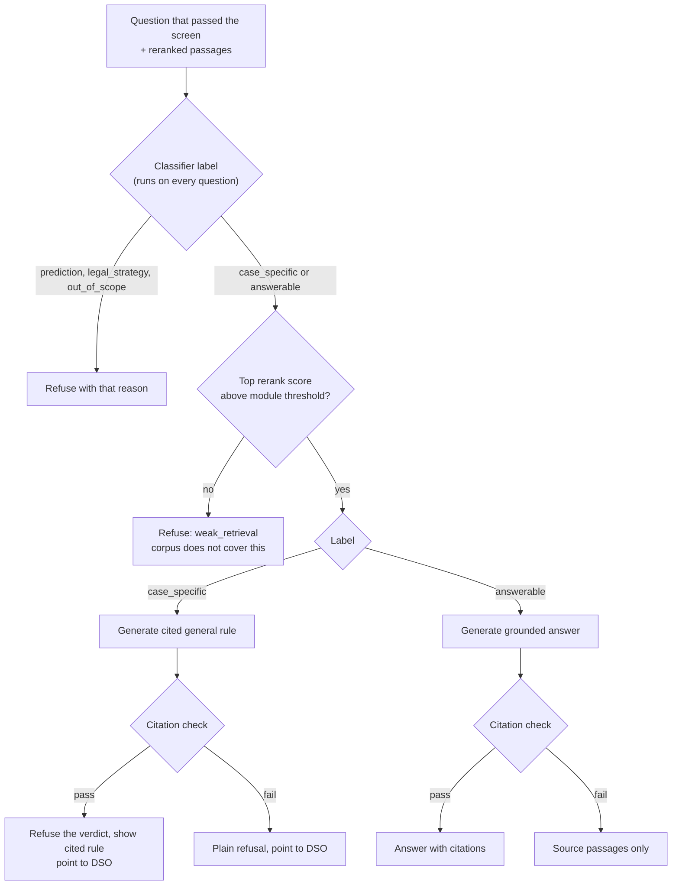
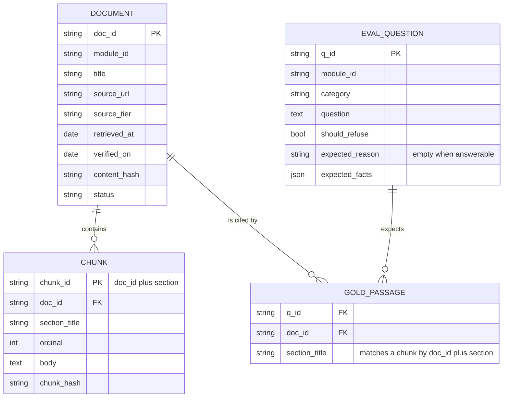

# F-1 Waypoint: Architecture

Diagrams use Mermaid.

## Modules

The product is a student platform with one module in v1. A module is a self-contained topic with its own source registry, eval set and eval results, plus a small `module.yaml` with four fields: `id`, `covered_topics`, `retrieval_threshold` and `referrals`. Shared code (ingestion, retrieval, generation, refusal gate, citation checker, eval harness, model wrapper) lives in `core/` and takes a module ID. v1 ships `opt_stem`. Adding a topic later means adding a folder, a registry, an eval set and a boundary, not changing the pipeline.

The model wrapper has two roles, a classifier and a generator. Each is mapped to a model and provider in one config file, pinned with no silent fallback. Changing a model requires a new accepted eval run.

## System overview



Read it as two loops that meet at the live corpus. The top loop builds and vets the corpus. The bottom loop answers questions from it. They share only the registry and the indexes, and a changed source reaches students only after the eval passes.

### Offline pipeline



### Online request path



## Query sequence (Ask view)



For an answerable question, a failed quote check degrades to showing the source passages instead of a synthesized answer; a failed summary alone shows the verified quotes without it. For a case-specific question a failed quote degrades to a plain refusal with the referral. If a model call fails, the student gets the passages with a notice.

## Refusal gate



The classifier runs on every question that passes the screen, and its label is combined with the retrieval score. Prediction, legal strategy and out of scope win over weak retrieval, because those refusals need no retrieved text. Weak retrieval wins over case-specific, because a case-specific response must cite the general rule. The threshold, the prefilter keywords and the classifier prompt are tuned on the eval set, and the chosen values and the failures behind them are recorded.

## Data model



Document IDs never change when a page is re-fetched. A chunk ID derives from the document ID plus the section, so gold passages survive a content edit unless the section itself disappears, which should break the eval on purpose.

## API sketch

| Endpoint | Purpose |
|---|---|
| `POST /ask` | Ask view. Takes `question` and `module`, single-turn. Returns an answer with quoted claims and citations, the quotes alone, the source passages, a refusal or a rejection |
| `GET /scripts` | Application question scripts with cited reasons |
| `GET /employer-brief` | One-page brief with citations and verified-on date |
| `GET /sources/{chunk_id}` | Source drawer content: passage, document, section, official URL, tier |
| `GET /health` | Liveness and corpus version (built) |
| `POST /feedback` | Report a wrong answer, only after the user confirms |

```json
{
  "status": "answered | quotes_only | passages_only | refused | rejected",
  "message": "string, every status but answered",
  "answer": "string, only when the summary passed the check",
  "rule": "string",
  "claims": [{ "text": "exact quote", "chunk_ids": ["string"], "markers": [1] }],
  "citations": [{ "n": 1, "chunk_id": "string", "doc_id": "string", "section": "string", "source_url": "string", "verified_on": "YYYY-MM-DD" }],
  "not_covered": "string",
  "notices": ["string, when a rule in the answer's area is in flux"],
  "passages": [{ "doc_id": "string", "section": "string", "source_url": "string", "chunk_ids": ["string"], "text": "string", "verified_on": "YYYY-MM-DD" }],
  "reason": "weak_retrieval | prediction | case_specific | legal_strategy | out_of_scope",
  "referral": { "key": "string", "label": "string", "url": "string" },
  "disclaimer": "string"
}
```

`claims` and `citations` appear on `answered` and `quotes_only`, and on a `refused` response only for the case-specific reason; those quotes go through the same check. A model failure returns an error code and a plain message when retrieval was weak.

## Freshness

A scheduled job re-crawls every source, compares content hashes, and lists changed and removed pages. A corpus update goes live only after the eval re-runs with no regression against the last accepted run. Removed pages are deleted from the index, with no leftover chunks. A page confirmed by a successful re-crawl gets a new verified-on date, and the UI marks sources as possibly out of date after 14 days.

## Failure handling

| Failure | Handling |
|---|---|
| A quote is not word for word in its cited passage | One-word slips are replaced by the source text; otherwise passages shown with no synthesized answer |
| The summary uses a number, form or term that is not in the quotes | The verified quotes are shown without the summary |
| A passage from a rule that is no longer in force | Dropped before ranking; a notice shows when the question touches it |
| Near-duplicate chunks | Drop copies from other pages, join pieces of the same section, before generation |
| Source page removed or restructured | Freshness job flags it, eval fails on the affected gold passages |
| Table extraction mangled | Manual spot-check, table-aware extraction, registry validation |
| Model API down or over budget | Passages with a notice; case-specific questions get a plain refusal |
| Abuse of the public demo | Layered rate limits and spend caps |
| Question about a topic with no module | Scoped refusal naming what the product covers today |
