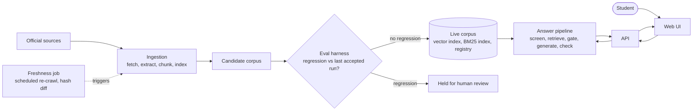
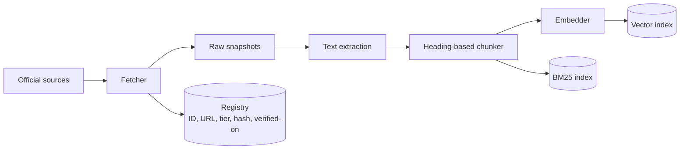
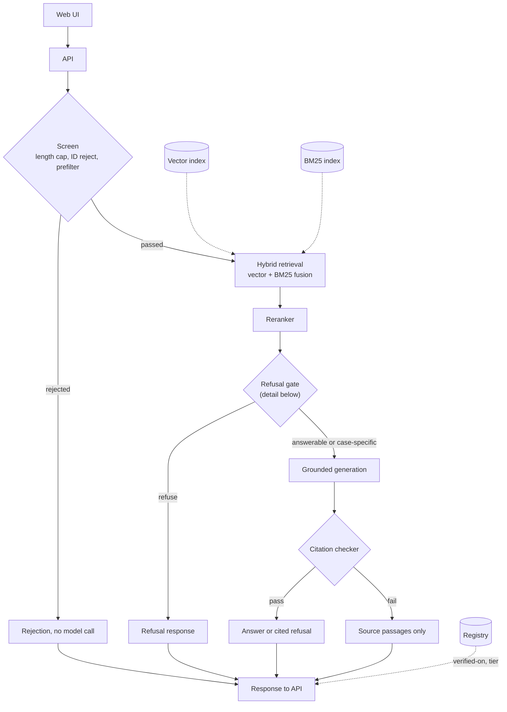
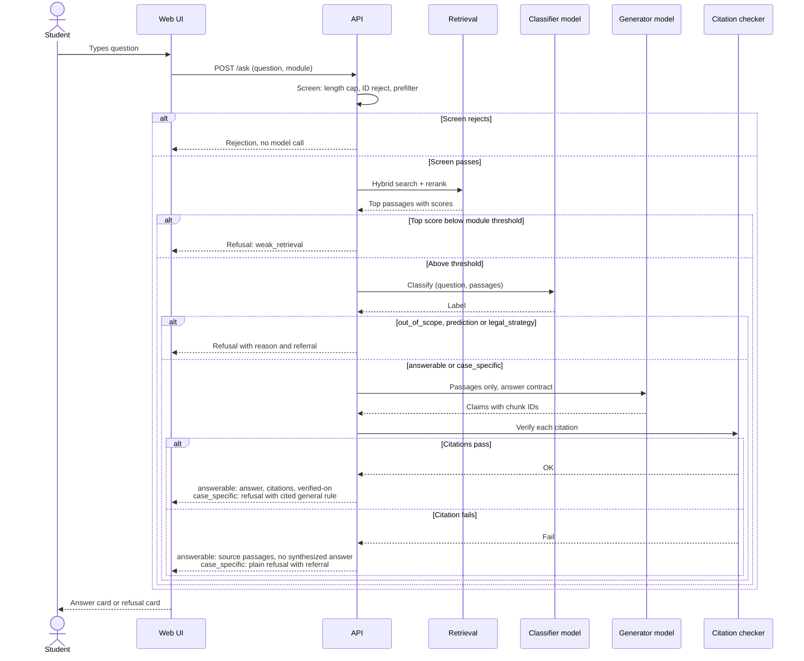
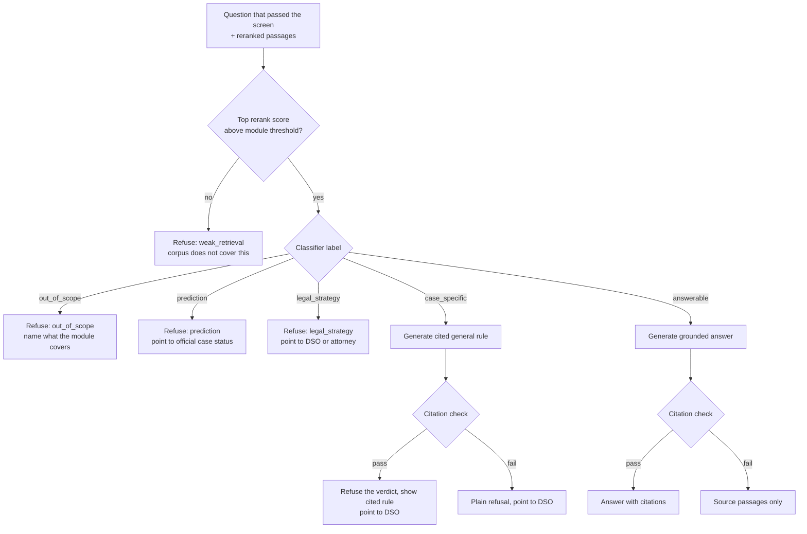
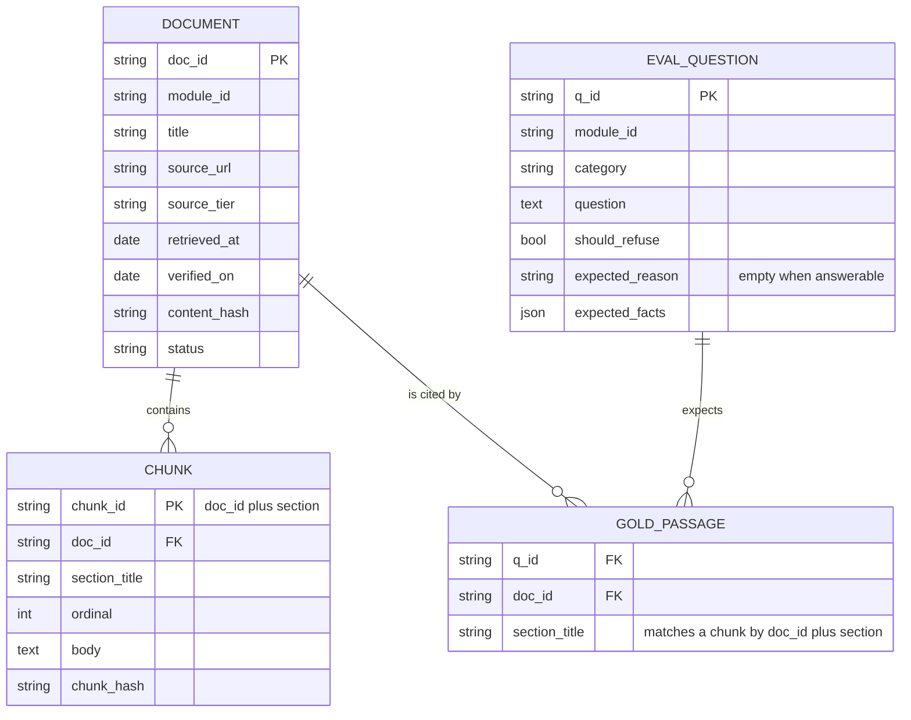

# F-1 Waypoint: Architecture

Diagrams use Mermaid.

## Modules

The product is a student platform with one module in v1. A module is a self-contained topic with its own source registry, eval set and eval results, plus a small `module.yaml` with four fields: `id`, `covered_topics`, `retrieval_threshold` and `referrals`. Shared code (ingestion, retrieval, generation, refusal gate, citation checker, eval harness, model wrapper) lives in `core/` and takes a module ID. v1 ships `opt_stem`. Adding a topic later means adding a folder, a registry, an eval set and a boundary, not changing the pipeline.

The model wrapper has two roles, a classifier and a generator. Each is mapped to a model and provider in one config file, pinned with no silent fallback. Changing a model requires a new accepted eval run.

## System overview



Read it as two loops that meet at the live corpus. The top loop builds and vets the corpus. The bottom loop answers questions from it. They share only the registry and the indexes, and a changed source reaches students only after the eval passes.

### Offline pipeline



### Online request path



## Query sequence (Ask view)



For an answerable question, a failed citation check degrades to showing the source passages instead of a synthesized answer. For a case-specific question it degrades to a plain refusal with the referral.

## Refusal gate



The threshold is checked before the classifier, so a case-specific question with weak retrieval is refused as weak retrieval. The threshold, the prefilter patterns and the classifier prompt are tuned on the eval set, and the chosen values and the failures behind them are recorded.

## Data model



Document IDs never change when a page is re-fetched. A chunk ID derives from the document ID plus the section, so gold passages survive a content edit unless the section itself disappears, which should break the eval on purpose.

## API sketch

| Endpoint | Purpose |
|---|---|
| `POST /ask` | Ask view. Takes `question` and `module`, single-turn. Returns the answer, claims with chunk IDs, or a refusal |
| `GET /scripts` | Application question scripts with cited reasons |
| `GET /employer-brief` | One-page brief with citations and verified-on date |
| `GET /sources/{chunk_id}` | Source drawer content: passage, document, section, official URL, tier |
| `GET /health` | Liveness and corpus version |
| `POST /feedback` | Report a wrong answer, only after the user confirms |

```json
{
  "status": "answered | refused",
  "answer": "string",
  "claims": [{ "text": "string", "chunk_ids": ["string"] }],
  "refusal": { "reason": "weak_retrieval | prediction | case_specific | legal_strategy | out_of_scope", "referral": "DSO | SEVP | USCIS" },
  "verified_on": "YYYY-MM-DD"
}
```

Claims are allowed on a refusal only for the case-specific reason, and they go through the same citation checker.

## Freshness

A scheduled job re-crawls every source, compares content hashes, and lists changed and removed pages. A corpus update goes live only after the eval re-runs with no regression against the last accepted run. Removed pages are deleted from the index, with no leftover chunks. A page confirmed by a successful re-crawl gets a new verified-on date, and the UI marks sources as possibly out of date after 14 days.

## Failure handling

| Failure | Handling |
|---|---|
| Cited passage does not exist or lacks the claimed number | Citation check fails, passages shown with no synthesized answer |
| Near-duplicate chunks | Deduplicate by document and section before generation |
| Source page removed or restructured | Freshness job flags it, eval fails on the affected gold passages |
| Table extraction mangled | Manual spot-check, table-aware extraction, registry validation |
| Model API down or over budget | Passages only, with a notice |
| Abuse of the public demo | Layered rate limits and spend caps |
| Question about a topic with no module | Scoped refusal naming what the product covers today |
